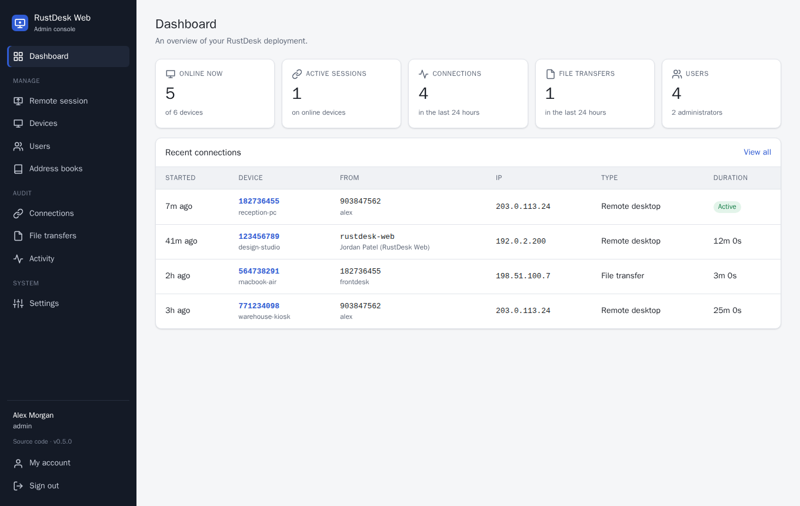
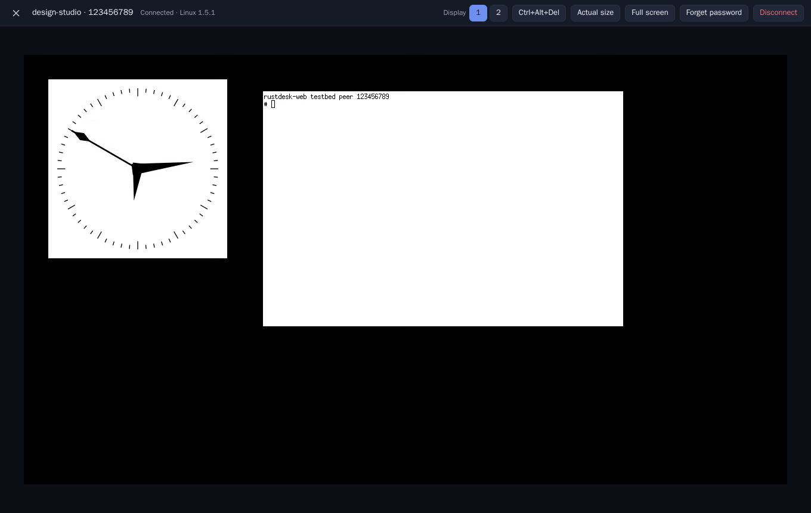
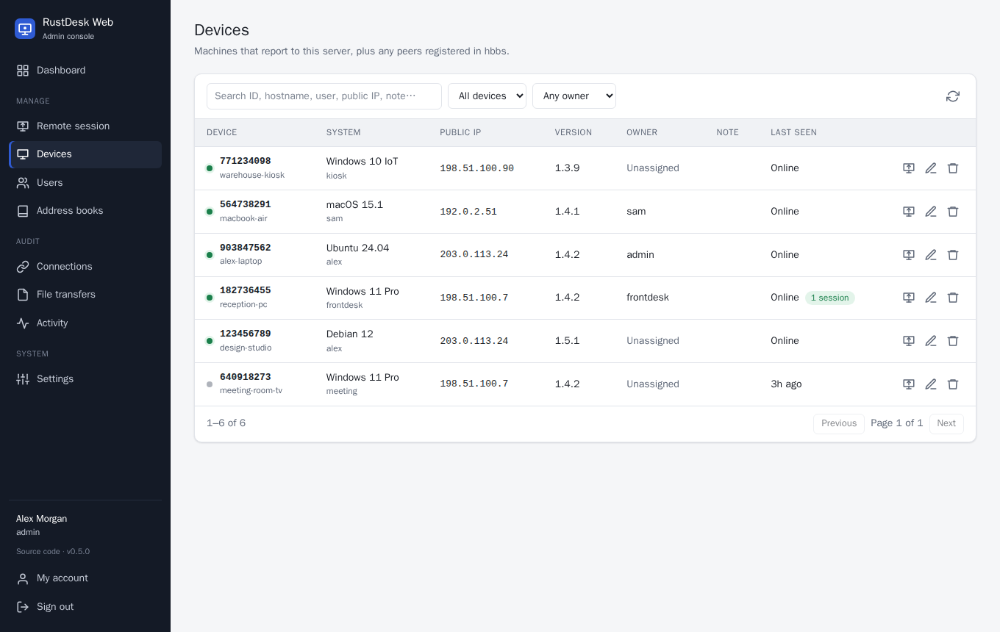
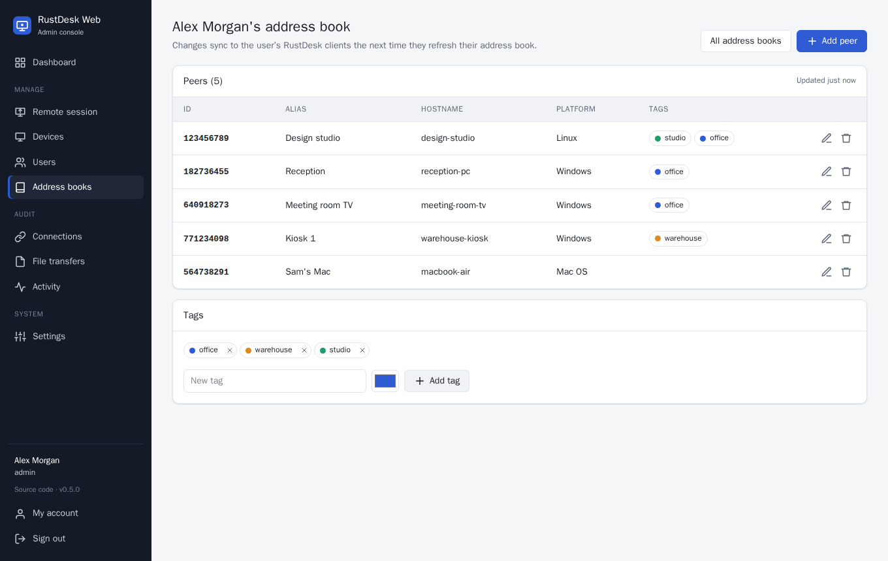
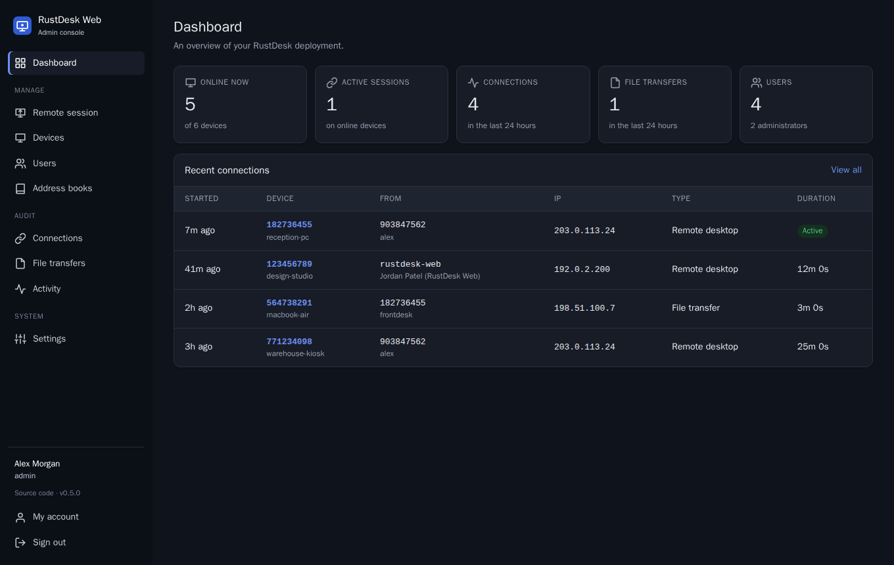

# rustdesk-web

A self-hosted **admin web console and API server for [RustDesk](https://github.com/rustdesk/rustdesk) OSS**.

The open-source RustDesk server (`hbbs`/`hbbr`) handles ID registration and relaying,
but it has no accounts, address books, device inventory or audit logs. rustdesk-web
implements the client-side **"API server"** protocol and adds a web console on top:

- **Accounts.** Users sign in from the RustDesk client. Administrators manage users,
  reset passwords and revoke sessions.
- **Address books.** Each user's address book syncs to every client they sign in on.
  Admins can view and edit peers and tags from the browser.
- **Device inventory.** Online status from client heartbeats, plus system information
  (OS, hostname, CPU, memory, version), owner, notes, and peers imported from hbbs.
- **Audit logs.** Incoming connections (who, from where, how long, what type), file
  transfers, and an activity log of sign-ins and admin changes.
- **Remote sessions in the browser.** Connect to any device from the console, with no
  RustDesk app on the admin's machine: view the screen, use mouse and keyboard, copy and
  paste text both ways, switch between the device's monitors, send Ctrl+Alt+Del. Sessions are relayed through your own hbbs/hbbr and end-to-end encrypted.
- **Cloudflare Zero Trust.** Behind a Cloudflare Access application, administrators can
  link their Access identity and are signed in automatically. Client IPs can be taken
  from `CF-Connecting-IP`.
- **Client setup.** Generates the importable configuration string and the
  self-configuring Windows installer file name.

It is a single small Node.js app with **no runtime dependencies** and **no build step**.
It stores its data in SQLite.



<details>
<summary>More screenshots</summary>






</details>

> rustdesk-web is a community project. It is not affiliated with or endorsed by
> RustDesk or Purslane Ltd. "RustDesk" is used only to describe compatibility.

## Quick start (Docker Compose)

The included `docker-compose.yml` runs hbbs, hbbr and the console together:

```bash
git clone https://github.com/stroebs/rustdesk-web.git
cd rustdesk-web
docker compose up -d
docker compose logs rustdesk-web   # the initial admin password is printed here
```

Open `http://<your-host>:21114` and sign in as `admin`. Then go to **Settings**, fill in
your ID server and API server, and copy the configuration string.

Already running hbbs? Run only the console, mounting your existing hbbs data directory:

```bash
docker run -d --name rustdesk-web -p 21114:21114 \
  -v rustdesk-web-data:/data \
  -v /path/to/hbbs-data:/hbbs:ro \
  -e HBBS_DB_PATH=/hbbs/db_v2.sqlite3 -e HBBS_KEY_FILE=/hbbs/id_ed25519.pub \
  stroebs/rustdesk-web:latest
```

Images are published to [Docker Hub](https://hub.docker.com/r/stroebs/rustdesk-web)
for `linux/amd64` and `linux/arm64`.

## Running without Docker

Requires Node.js **24 or newer**.

```bash
ADMIN_PASSWORD='choose-a-strong-one' npm start
```

Data goes to `./data/rustdesk-web.sqlite3` by default.

## Remote sessions in the browser

Open **Remote session** in the sidebar, or the connect icon next to a device, enter the
password shown on that device, and the session opens in the browser.

**Remember password** (checked by default) saves the password for your console account,
so the next session to that device opens without asking. Like the RustDesk app, the
console stores only `sha256(password + device salt)`, never the password, and it never
sends that back to the browser: it answers the device's login challenge itself. A saved
password is dropped when the device rejects it or its password changes. Forget one from
the session toolbar or under **My account → Saved device passwords**.

How it works: the browser speaks RustDesk's own protocol over WebSocket. The console
proxies `/ws/id` to hbbs (port 21118) and `/ws/relay` to hbbr (port 21119), only for
signed-in administrators. The session is end-to-end encrypted between the browser and the
device (NaCl, the same key exchange as the native client), so the console and the relay
cannot read it. The device's identity is verified against your server's public key, and
the client refuses to connect if that check fails.

Requirements:

- **HTTPS.** Browsers only decode video (WebCodecs) on secure pages. Serve the console
  over HTTPS, through a reverse proxy or with `TLS_CERT_FILE`/`TLS_KEY_FILE`.
  `http://localhost` also works, for testing.
- **The server's public key** in Settings (or `HBBS_KEY_FILE`/`SERVER_KEY`).
- **The console can reach hbbs/hbbr** on their WebSocket ports. By default it uses the ID
  and relay servers from Settings with ports 21118/21119. Set `HBBS_WS_URL` and
  `HBBR_WS_URL` if it must use other addresses (for example when the ID server name only
  resolves publicly).
- A current Chrome, Edge, Firefox or Safari.

**Clipboard.** Text copied on the device is placed on your clipboard (if the browser
refuses, a *Copy remote clipboard* button appears). Pressing Ctrl+V (⌘V on a Mac) in the
viewer sends your clipboard to the device and pastes it there. Only plain text is
exchanged.

**Multiple monitors.** When the device has more than one display, buttons in the toolbar
switch between them.

Current limitations: no file transfer or audio, images and rich text are not copied, and the
remote cursor is not drawn (your own pointer is used). Sessions always use the relay; direct
connections are not possible from a browser.

Starting a session is recorded in **Activity**, and the device reports it under
**Connections** like any other session, as coming from `rustdesk-web` with the admin's name.

## Configuring RustDesk clients

In the RustDesk client, open **Settings → Network → ID/Relay server** and either paste
the configuration string from the console's Settings page, or fill in:

| Field        | Value                                                              |
|--------------|--------------------------------------------------------------------|
| ID server    | your hbbs host                                                     |
| Relay server | your hbbr host (if different)                                      |
| API server   | the URL of this console, e.g. `https://rustdesk.example.com`       |
| Key          | contents of hbbs's `id_ed25519.pub`                                |

After that, clients:

- show a **Login** button (top-right in the desktop client) for sign-in and address book sync,
- send heartbeats and system information, so they appear under **Devices**,
- report connections and file transfers, which appear under **Audit**.

## Configuration

All settings are environment variables. Client-facing addresses and the Cloudflare
settings can also be changed in the console. Values saved there override the environment.

| Variable                  | Default                       | Description |
|---------------------------|-------------------------------|-------------|
| `PORT`                    | `21114`                       | HTTP port (21114 is the conventional RustDesk API port). |
| `HOST`                    | `0.0.0.0`                     | Bind address. |
| `DATA_DIR`                | `./data` (`/data` in Docker)  | Where the SQLite database lives. |
| `DB_PATH`                 | `$DATA_DIR/rustdesk-web.sqlite3` | Override the database file path. |
| `ADMIN_USERNAME`          | `admin`                       | Initial administrator, created only when there are no users. |
| `ADMIN_PASSWORD`          | *(random, printed to the log)* | Initial administrator password. |
| `HBBS_DB_PATH`            |                               | Path to hbbs's `db_v2.sqlite3`. Registered peers are imported read-only. |
| `HBBS_KEY_FILE`           |                               | Path to hbbs's `id_ed25519.pub`, shown as the public key. |
| `HBBS_SYNC_SECONDS`       | `60`                          | How often to import peers from hbbs. |
| `ID_SERVER`, `RELAY_SERVER`, `API_SERVER`, `SERVER_KEY` | | Defaults for the client configuration. |
| `PUID`, `PGID`            | `1000` (Docker image)         | User/group the server runs as in Docker. The container starts as root only to take ownership of the data directory, then drops to this user. |
| `TLS_CERT_FILE`, `TLS_KEY_FILE` |                     | PEM certificate and key: serve HTTPS directly (needed for browser sessions unless a proxy terminates TLS). |
| `HBBS_WS_URL`, `HBBR_WS_URL` | `ws://<ID server>:21118`, `ws://<relay>:21119` | Where the console forwards browser sessions. |
| `SOURCE_URL`              | this repository               | Source code link shown in the UI (AGPL). Point it at your fork if you modify the code. |
| `TRUST_PROXY`             | `false`                       | Trust `X-Forwarded-For`/`-Proto` from one reverse proxy. |
| `CF_ACCESS_TEAM_DOMAIN`   |                               | Cloudflare Zero Trust team, e.g. `myteam` or `myteam.cloudflareaccess.com`. See [Cloudflare Zero Trust](#cloudflare-zero-trust). |
| `CF_ACCESS_AUD`           |                               | Application Audience (AUD) tag(s) of the console's Access application, comma-separated. |
| `CF_ACCESS_ENABLED`       | on when both of the above are set | Turn Access sign-in on or off. |
| `CF_ACCESS_AUTO_LOGIN`    | `true`                        | Sign linked administrators in automatically; `false` shows a "Continue as" button instead. |
| `CF_CLIENT_IP`            | `false`                       | Take client IPs from `CF-Connecting-IP`. Only when Cloudflare is the only way in. |
| `CF_TRUSTED_PROXIES`      | *(any)*                       | IPs/CIDRs (comma-separated) allowed to set `CF-Connecting-IP`, e.g. your cloudflared host. |
| `COOKIE_SECURE`           | `auto`                        | `auto` marks the cookie `Secure` on HTTPS requests; or `true`/`false`. |
| `ONLINE_THRESHOLD_SECONDS`| `60`                          | A device counts as online if its last heartbeat is newer than this. |
| `CLIENT_TOKEN_TTL_DAYS`   | `30`                          | Sliding lifetime of RustDesk client sign-ins. |
| `SESSION_TTL_HOURS`       | `12`                          | Sliding lifetime of console sessions. |
| `LOG_RETENTION_DAYS`      | `180`                         | Connection, file and activity logs older than this are deleted. |

### Behind a reverse proxy

RustDesk clients and the console only need plain HTTP(S) to this service. Example for
Caddy:

```
rustdesk.example.com {
    reverse_proxy 127.0.0.1:21114
}
```

Set `TRUST_PROXY=true` so client IPs and HTTPS detection work, and use
`https://rustdesk.example.com` as the API server in clients. Caddy proxies the WebSocket
upgrades for browser sessions automatically; with nginx, add
`proxy_set_header Upgrade $http_upgrade;` and `proxy_set_header Connection "upgrade";` for
`/ws/`.

### Cloudflare Zero Trust

If the console is published through a Cloudflare Tunnel and protected by a Cloudflare
Access application, administrators can use their Access sign-in instead of a password:

1. In Zero Trust, open **Access → Applications → your console's application** and copy
   the **Application Audience (AUD) tag**. Your team domain is under **Settings → Custom
   pages** (`<team>.cloudflareaccess.com`).
2. Enter both in **Settings → Cloudflare Zero Trust** (or set `CF_ACCESS_TEAM_DOMAIN` and
   `CF_ACCESS_AUD`).
3. Each administrator signs in with their password once and clicks **Link** under
   **My account**. Administrators can also set a user's Access e-mail in **Users**.

From then on, opening the console through Access signs them in. Every request carries
Cloudflare's JWT (`Cf-Access-Jwt-Assertion`, or the `CF_Authorization` cookie), which is
checked against the team's signing keys (RS256, fetched from
`https://<team>.cloudflareaccess.com/cdn-cgi/access/certs` and refreshed when keys
rotate), the issuer, the audience and its validity period. Service-token JWTs are
refused. A session started this way stays valid only while each request still carries a
valid token for the linked identity, so revoking someone in Cloudflare, unlinking them,
or turning the integration off ends their console session too. Password sign-in keeps
working, and signing out stops the automatic sign-in for that browser tab.

RustDesk clients can't complete an Access login, so their API server address must bypass
Access (a separate hostname or a Bypass policy, or the LAN address).

**Client IPs.** Behind a tunnel, every request appears to come from cloudflared. Turn on
**Client IP from CF-Connecting-IP** (`CF_CLIENT_IP=true`) to log the real address instead.
Anyone who can reach the port directly could forge this header, so either keep the port
private or list your cloudflared host(s) under **Trusted proxies** (`CF_TRUSTED_PROXIES`):
the header is then ignored on requests from anywhere else.

## Command-line tools

```bash
npm run cli -- reset-password admin             # prints a new random password
npm run cli -- create-admin alice 'password123'
npm run cli -- list-users
npm run cli -- config-string rd.example.com <key> https://rd.example.com
```

In Docker: `docker compose exec rustdesk-web node src/cli.js reset-password admin`.

## Compatibility notes

- **Address books** use RustDesk's original "legacy" address book protocol: one
  address book per user, with tags. The newer shared address book endpoints return
  404, which makes clients fall back to the legacy protocol automatically. Shared
  address books, device groups, strategies, OIDC and 2FA are
  [RustDesk Server Pro](https://rustdesk.com/pricing) features and are not implemented.
- A device is assigned to the account that last signed in on it.
- Telemetry and audit endpoints are unauthenticated by protocol design. See
  [SECURITY.md](SECURITY.md).

## Development

```bash
npm run dev     # auto-restart on change
npm test        # unit and API tests
npm run e2e     # browser-client protocol test against a real RustDesk peer (Docker)
```

`testbed/` is a complete environment for trying the browser client: hbbs, hbbr, a
headless RustDesk peer showing a clock and a terminal, and the console built from this
checkout.

```bash
docker compose -f testbed/compose.yml up -d --build
# open http://localhost:21180, sign in as admin / testbed-admin,
# connect to 123456789 with password testbed-password
```

See [CONTRIBUTING.md](CONTRIBUTING.md) for the project layout and conventions.

## License

[GNU AGPL-3.0](LICENSE), the same license as RustDesk itself. If you run a modified
version as a network service, you must offer its source code to the people who use it.

Versions up to and including 0.1.3 were released under the MIT license.

The browser client implements RustDesk's protocol using its protocol definitions (`proto/`,
AGPL-3.0, © Purslane Ltd). Icons are adapted from [Feather](https://feathericons.com) (MIT).
TweetNaCl-js is vendored under its public-domain dedication (Unlicense), and
[fzstd](https://github.com/101arrowz/fzstd) under the MIT license.
